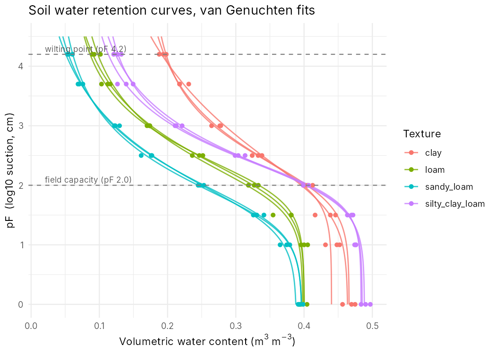
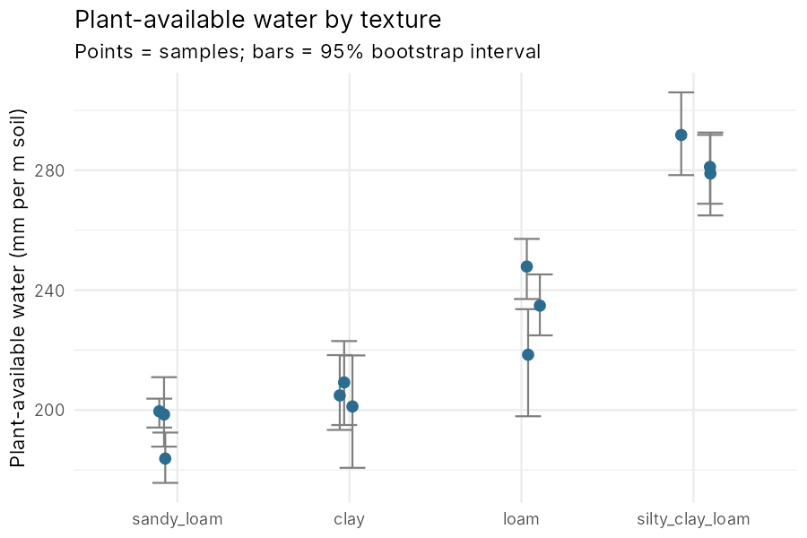

# soil-water-retention-fi


Fitting soil water retention curves (pF curves) and estimating plant-available water, in R.

During my research assistant work in the Vesima project (Salaojayhdistys / Aalto University, 2024) I measured soil water retention and particle-size distribution for Finnish agricultural soils and built pF curves by hand from the lab data. This repository is the workflow I would want to have had then: it fits a model to the measurements, calculates the hydraulic properties that matter for crops and catchment hydrology, says how uncertain they are, and makes the figures.

The original Vesima data belong to the project, so the example data here are synthetic (see [Data](#data)).

## What it does

For each soil sample with water content measured at several suctions (pF steps):

1. Fits the **van Genuchten (1980)** retention model with bounded non-linear least squares, trying several starting values so the fit does not get stuck.
2. Calculates **field capacity** (pF 2.0), **permanent wilting point** (pF 4.2), **plant-available water** (mm per metre of soil) and **air capacity**.
3. Estimates a **95% bootstrap interval** for plant-available water.
4. Tests whether plant-available water differs between textures (**one-way ANOVA + Tukey HSD**).
5. Writes result tables and figures to `results/`.

## Results on the example data



| Texture | Field capacity (m³/m³) | Wilting point (m³/m³) | Plant-available water (mm/m) |
|---|---|---|---|
| Clay | 0.40 | 0.19 | 205 |
| Silty clay loam | 0.41 | 0.12 | 284 |
| Loam | 0.33 | 0.09 | 234 |
| Sandy loam | 0.25 | 0.06 | 194 |



The point worth noticing: clay holds as much water as silty clay loam at field capacity, but it holds far more of it at the wilting point, where plants cannot extract it. So the wettest soil is not the one with the most water for crops. Texture differences in plant-available water were significant (ANOVA, p < 0.001); full output in `results/anova_paw.txt`.

## How to run

Requires R (≥ 4.1) with `ggplot2` and `testthat`.

```r
install.packages(c("ggplot2", "testthat"))
```

From the repository root:

```bash
Rscript scripts/run_analysis.R                     # example data
Rscript scripts/run_analysis.R my_measurements.csv # your own data
Rscript -e 'testthat::test_dir("tests/testthat")'  # unit tests
```

Your CSV needs four columns: `sample_id`, `texture`, `pF`, `theta` (volumetric water content, m³/m³), with at least 5 pF steps per sample.

## Data

`data/example_retention.csv` is **synthetic**. It is generated by `scripts/make_example_data.R` from the class-average van Genuchten parameters of the ROSETTA model (Schaap et al. 2001) for four textures, with small random noise added. Clay and silty clay loam are included because they dominate field soils in southern Finland. The pF steps match a standard sandbox and pressure plate series. The data are for demonstrating the method, not for drawing conclusions about real soils.

## Repository layout

```
R/vg_model.R                 model, fitting, hydraulic properties, bootstrap
scripts/make_example_data.R  builds the synthetic example dataset
scripts/run_analysis.R       full analysis: fits, tables, ANOVA, figures
tests/testthat/              unit tests (run automatically on every push)
results/                     output tables and figures
```

## Limitations

- With 7–8 points per sample, the four-parameter fit is sensitive to the dry end of the curve; the bootstrap interval shows this but is itself rough with so few points.
- Field capacity is fixed at pF 2.0 (Nordic convention). Some studies use pF 2.5; it is an argument in `hydraulic_properties()`.
- Hysteresis, shrink–swell behaviour of clays and stone content are not modelled.

## Next steps

- Link sample-level plant-available water to land cover and lidar-derived canopy metrics, to look at how vegetation and soil together control water storage at catchment scale.
- Add pedotransfer functions so retention can be estimated from texture and organic carbon where no pF measurements exist.

## References

- van Genuchten, M.Th. (1980). A closed-form equation for predicting the hydraulic conductivity of unsaturated soils. *Soil Science Society of America Journal* 44: 892–898.
- Schaap, M.G., Leij, F.J., van Genuchten, M.Th. (2001). ROSETTA: a computer program for estimating soil hydraulic parameters with hierarchical pedotransfer functions. *Journal of Hydrology* 251: 163–176.

## Author

Sadia Jamin Haque Suchi, MSc (Tech.) Water and Environmental Engineering, Aalto University.
[LinkedIn](https://www.linkedin.com/in/sadia-suchi/)

License: MIT
